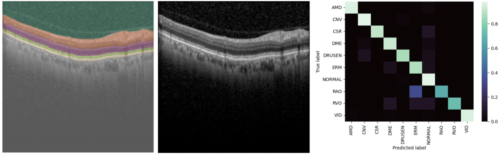

# Building deep learning based layer segmentation and pathology classification models in retinal OCT images

This repository shares code and data used in the project. For detailed information, please check the technical report. *The repository is still under development, and further information will be added.

Todo:
Consideration of the license

## Datasets
Datasets used in this project can be found [here](https://drive.google.com/drive/folders/13wXC3LZ75CPKXMQS2ocfrertOU7PoTSQ?usp=sharing). 

Layer segmentation task:
OCT5k dataset was used for training the layer segmentation model. The datasets used are in oct5k_outputs/ directory in the drive. For the preparation, we used the scripts in the OCT5k dataset. The dataset can be downloaded from [the official archive](https://rdr.ucl.ac.uk/articles/dataset/OCT5k_A_dataset_of_multi-disease_and_multi-graded_annotations_for_retinal_layers/22128671/4?file=44436359).

Classification task:
The dataset creation script for classification is found in classification/ directory in the drive.

## Layer segmentation 
U-Net was used for the layer segmentation. This [repository](https://github.com/KogenNobori/Pytorch-UNet) was used in training and analysis. Branches without_noise, speckle_10p_m0v0.5, speckle_10p_m0v1 were used for the three training and testing settings discussed in the report.

## Classification
ResNet and Swin Transformer were trained for classification. The Kaggle Notebooks used are included in classification/ directory.

