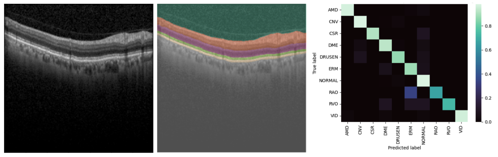

# Building deep learning based layer segmentation and pathology classification models in retinal OCT images


This repository shares code and data used in the project. For detailed information, please check the technical report. *The repository is still under development, and further information will be added.

### Todo:
Consideration of the license, consideration of the OCT5k scripts used

# Datasets
Datasets used in this project can be found [here on Google Drive](https://drive.google.com/drive/folders/1BEMyyOkUQyTVCfcUH5FH_XqIwuxkk25_?usp=sharing). 

### Layer segmentation task:
OCT5k dataset was used for training the layer segmentation model. The datasets used are in `oct5k_outputs/` directory in the drive. For the preparation, we used the scripts in the OCT5k dataset. The dataset can be downloaded from [the official archive](https://rdr.ucl.ac.uk/articles/dataset/OCT5k_A_dataset_of_multi-disease_and_multi-graded_annotations_for_retinal_layers/22128671/4?file=44436359).

#### Directory structure:
```
oct5k_outputs
├── converter.ipynb
├── noise_addition.ipynb
├── oct5k_output
│   ├── test_img
│   ├── test_msk
│   ├── train_img
│   ├── train_msk
│   ├── valid_img
│   └── valid_msk
├── oct5k_output_rgb_new_test
│   ├── img
│   ├── img_noise_added_10p_m0v0.25
│   ├── img_noise_added_10p_m0v0.5
│   ├── img_noise_added_10p_m0v1
│   └── msk
├── oct5k_output_test_converted4test
│   ├── test_img_rgb
│   └── test_msk
├── oct5k_output_train_converted4train
│   ├── train_img_rgb
│   ├── train_img_rgb_noise_added_10p_m0v0.25
│   ├── train_img_rgb_noise_added_10p_m0v0.5
│   ├── train_img_rgb_noise_added_10p_m0v0.75
│   ├── train_img_rgb_noise_added_10p_m0v1
│   └── train_msk
├── oct5k_output_valid_converted4valid
│   ├── valid_img_rgb
│   └── valid_msk
└── visualise.ipynb
```
`converter.ipynb`...The script used for manipulation of the dataset.

`noise_addition.ipynb`...The script used for addition of speckle noise to the training and test dataset.

### Classification task:
The dataset used for the classification task is placed in the zipped form as `combined3_split_rgb_jpeg.zip` in the Drive. The dataset creation script for classification is found as `classification/dataset_creator.ipynb` in this repository.


# Training models

## Layer segmentation model 
U-Net was used for the layer segmentation. This [repository](https://github.com/KogenNobori/Pytorch-UNet) was used in training and analysis. Branches `without_noise`, `speckle_10p_m0v0.5`, `speckle_10p_m0v1` were used for the three training and testing settings discussed in the report. 


## Classification model
ResNet and Swin Transformer were trained for classification. The Kaggle Notebooks used are included in `classification/` directory. 

## Trained models
The trained models for layer segmentation and classification can be found via the links in the table below.

| Segmentation       | Classification |
|--------------------|----------------|
| [without_noise](https://drive.google.com/drive/folders/1bTbhaxbTjpxL4eNqFJCBGx1AfcHdCFI4?usp=sharing)      | [ResNet-34](https://drive.google.com/drive/folders/1IYn0Q4z-EYv8h6o3_FpDmtbG7WtRj6H4?usp=sharing)      |
| [speckle_10p_m0v0.5](https://drive.google.com/drive/folders/1CQjfBFxTWKLO7grzdc0oPfQ2QwUclr0J?usp=sharing) | [Swin-T](https://drive.google.com/drive/folders/1yEDsw4hHVlXlSVYLhV6GsGdS4fXnIMJS?usp=sharing)         |
| [speckle_10p_m0v1](https://drive.google.com/drive/folders/1jCqCHZ91DKkgxz0_AMNnE6dbRLIYB4qK?usp=sharing)   |                |


